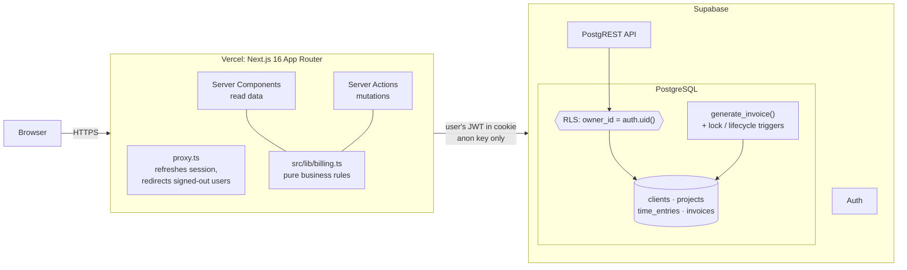
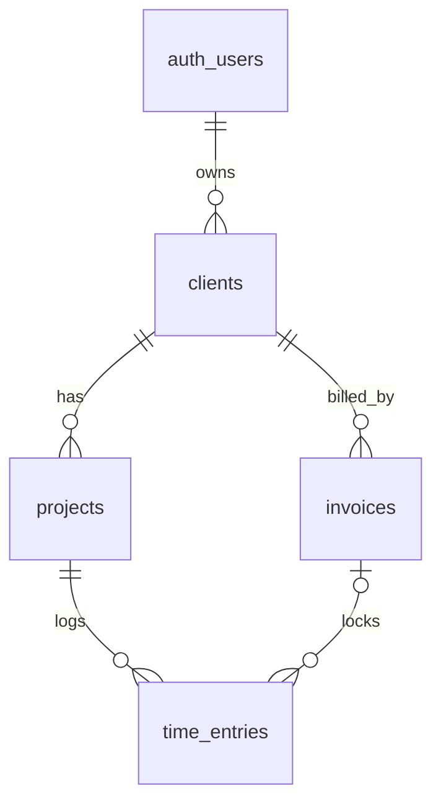

# Billable

[](https://github.com/YOUR_GITHUB_USER/billable/actions/workflows/ci.yml)
[](https://codecov.io/gh/YOUR_GITHUB_USER/billable)

**Project time and billing tracker for service businesses: proposal → delivery → invoice, with a warning before a project blows its budget.**

**Live demo:** https://YOUR-APP.vercel.app (sign up with any email)


## What it does

| Area | Features |
| --- | --- |
| **Login** | Supabase email + password. Every user sees only their own data, enforced in Postgres by Row Level Security. |
| **Clients** | Create, list, edit, delete. |
| **Projects** | Client, hourly rate, budgeted hours, start/end dates, status `proposal → active → completed`. |
| **Time** | Log hours per project, billable or not. CSV export. |
| **Invoices** | Generated from a client's unbilled billable hours. Numbered `INV-0001…`, moves `draft → sent → paid`. The hours it covers are locked to it. Print / save as PDF. |
| **Dashboard** | Billed vs. unbilled revenue, budget burn % per project, and a **forecast flag** when a project's burn rate puts it on track to exceed its budget. |

### The forecast

If a project has used 80% of its hours but only 50% of its timeline has passed, it's burning 1.6× faster than planned. If that pace continues, it ends at **160%** of budget, and the dashboard flags it.

```
projected % = (hours used / budget hours) / (elapsed days / total days) × 100
```

## Architecture



The app never holds a service-role key. Every query runs as the signed-in user, so **Postgres decides what each user can see**, not application code. Even a bug in a Server Action can't leak another tenant's data.

## Data model



| Table | Key columns |
| --- | --- |
| `clients` | `name`, `email` |
| `projects` | `client_id`, `status` (proposal/active/completed), `hourly_rate`, `budget_hours`, `start_date`, `end_date` |
| `time_entries` | `project_id`, `invoice_id` (null = unbilled), `entry_date`, `hours` (0–24], `billable` |
| `invoices` | `client_id`, `number` (unique per user), `status` (draft/sent/paid), `tax_rate`, `total` |

Every table has `owner_id uuid default auth.uid()`.

### Why Row Level Security

Billable is multi-tenant: one database, many businesses. RLS moves tenant isolation from "every query must remember a `WHERE owner_id = …`" to a rule the database enforces on **every** read and write:

```sql
create policy "owner_all" on clients for all
  using (owner_id = auth.uid())        -- which rows you can see / update / delete
  with check (owner_id = auth.uid());  -- which rows you can create
```

[`0002_hardening.sql`](supabase/migrations/0002_hardening.sql) adds what RLS alone doesn't cover:

- **Same-owner foreign keys.** Postgres foreign-key checks bypass RLS. With the original schema, user B could create a project pointing at user A's `client_id` if they knew the UUID. Composite keys such as `(client_id, owner_id) → clients(id, owner_id)` make that impossible.
- **`generate_invoice()`** runs as `security invoker`, so RLS still applies inside it. In one transaction it assigns the next number, locks the client's unbilled billable hours to the invoice, and computes the total. If anything fails, nothing is written.
- **Triggers** stop edits and deletes on locked hours. They allow only `draft → sent → paid`, freeze issued invoices, and block deleting a project that has invoiced hours.

## Tests

| Layer | What | Command |
| --- | --- | --- |
| Unit (Vitest) | Billing rules in `src/lib`: totals, tax rounding, budget burn, forecast, status flow, CSV escaping. Written test-first. | `npm run test:coverage` |
| **Security (Vitest + real Supabase)** | Signs in as user B and proves they **cannot read, update, delete, forge or invoice** user A's data, or attach rows to it. A signed-out visitor gets nothing. | `npm run test:db` |
| Database rules | Invoice total matches the TypeScript rule, hours get locked, lifecycle is enforced, numbering is sequential. | `npm run test:db` |
| End-to-end (Playwright) | Sign up → add client → add project → log hours → generate invoice → see **$290.00**. | `npm run test:e2e` |

CI ([`.github/workflows/ci.yml`](.github/workflows/ci.yml)) runs lint, type-check and unit tests with coverage on every push. It then starts a throwaway Supabase in the runner and runs the security tests and the Playwright tests against it. Trivy scans dependencies, secrets and config, and Dependabot keeps npm and Actions current.

## Run it locally

Prerequisites: Node 22+, Docker Desktop running.

```bash
npm install
npx supabase start            # starts Postgres, Auth and the API in Docker, then applies migrations
cp .env.example .env.local    # paste the API URL and anon / publishable key that `supabase start` printed
npm run dev                   # http://localhost:3000
```

Run the tests:

```bash
npm test                      # unit tests
npm run test:coverage         # unit tests + coverage report
npm run test:db               # RLS security + database rule tests (needs `supabase start`)
npx playwright install chromium   # first time only
npm run test:e2e              # end-to-end (needs `supabase start`)
```

Other useful commands: `npm run db:reset` (wipe and re-apply migrations) and `npm run db:types` (regenerate TypeScript types from the schema).

## Deploy

1. Create a free project at [supabase.com](https://supabase.com), then `npx supabase link --project-ref <ref>` and `npx supabase db push`.
2. In Supabase → Authentication → URL Configuration, set the Site URL to your Vercel URL and add `https://<your-app>.vercel.app/auth/confirm` as a redirect URL.
3. Import the repo into [Vercel](https://vercel.com) and add `NEXT_PUBLIC_SUPABASE_URL` and `NEXT_PUBLIC_SUPABASE_ANON_KEY`.

## Stack

Next.js 16 (App Router, Server Actions) · TypeScript · Supabase (Postgres, Auth, RLS) · Tailwind CSS 4 · Vitest · Playwright · GitHub Actions · Trivy · Dependabot · Vercel

## Possible next steps

Live dashboard updates with Supabase Realtime · multi-currency · emailing invoices · per-entry rates
